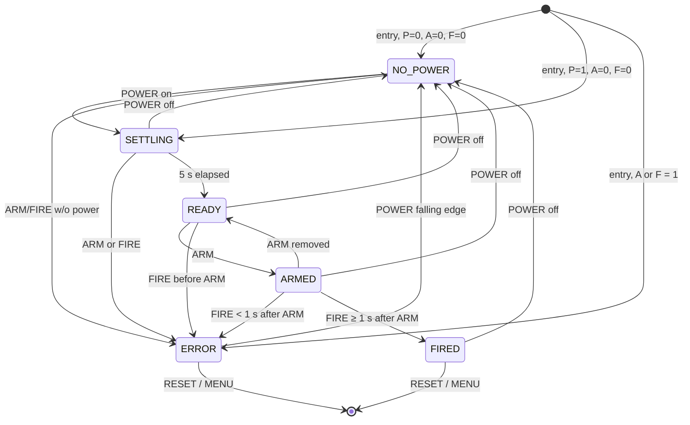

# WH Tester Only
# WH Board Tester — Functional & Technical Specification

| Item | Value |
|---|---|
| Document | SPEC.md |
| Version | 0.2 |
| Date | 2026-09-14 |
| Target hardware | M5Stack CoreS3 SE (ESP32-S3, 320×240 capacitive touch LCD) |
| Toolchain | PlatformIO, Arduino framework, M5Unified / M5GFX, LVGL 9.2 |
| Firmware | v0.2.3 — implemented, builds; hardware testing in progress |
| Status | Software decisions resolved; hardware items open — see §14 |

---

## 1. Purpose & Scope

A handheld tester for the **WH Board**. The tester has two test modes, chosen from a touchscreen menu:

1. **Internal Connector mode.** The tester reads three digital outputs from the WH Board (**POWER**, **ARM**, **FIRE**). It checks them against the required sequencing rules and shows the resulting state. It drives two digital signals (**GREEN**, **RED**) back to the WH Board to show that state.
2. **External Connector mode.** The WH Board's external connector (two wires) goes to a switchable load on the tester: **OPEN CCT**, **CLOSED CCT** (short), or a **1 Ω dummy load** with current measured by an **INA219**. In 1 Ω mode the tester shows the live current and declares **FIRED** when the current stays above **1.2 A** for at least 5 ms.

Both modes must show every input and output with bright coloured indicators, plus a clear status line. The FIRED indication must look the same in both modes.

> **Safety note:** The tester is only ever a stand-in for a real initiator. The 1 Ω resistor is a dummy load. The tester must never be connected in series with, or in parallel with, a live initiator.

---

## 2. Definitions

| Term | Meaning |
|---|---|
| Asserted / HIGH | Input signal at the logic-1 level (5 V at the WH Board, ~3.3 V at the GPIO after the divider) |
| Deasserted / LOW | Input signal at 0 V |
| Debounced | Input level has been stable for `INPUT_DEBOUNCE_MS` (5 ms) |
| Toggle interval | Time between output level changes (the half-period). "Toggle at 600 ms" = 600 ms ON, 600 ms OFF |
| Tick | One pass of the I/O and state-machine task (nominally 1 ms) |
| Latch | A state that stays in place after the condition that caused it goes away |

---

## 3. Hardware

### 3.1 Controller

- M5Stack CoreS3 SE: ESP32-S3, 16 MB flash, PSRAM, 2.0" 320×240 IPS with capacitive touch, speaker, USB-C.
- The CoreS3 SE has **no physical front buttons**. All user input is through on-screen touch buttons.

### 3.2 Pin Allocation

| Signal | GPIO | Dir | Active level | Connector | Notes |
|---|---|---|---|---|---|
| POWER (from WH) | **GPIO5** | IN | HIGH | M-Bus | 5 V → 3.3 V divider, pull-down |
| ARM (from WH) | **GPIO6** | IN | HIGH | M-Bus | 5 V → 3.3 V divider, pull-down |
| FIRE (from WH) | **GPIO7** | IN | HIGH | M-Bus | 5 V → 3.3 V divider, pull-down |
| GREEN (to WH) | **GPIO8** | OUT | HIGH = ON | Port B | 3.3 V → 5 V buffer required |
| RED (to WH) | **GPIO9** | OUT | HIGH = ON | Port B | 3.3 V → 5 V buffer required |
| LOAD_TEST (Open / Test) | **GPIO17** | OUT | HIGH = load connected | Port C | Relay driver, pull-down |
| LOAD_SELECT (Short / 1 Ω) | **GPIO18** | OUT | HIGH = 1 Ω, LOW = short | Port C | Relay driver, pull-down |
| INA219 SDA | GPIO2 | I/O | — | Port A | `M5.Ex_I2C` |
| INA219 SCL | GPIO1 | OUT | — | Port A | `M5.Ex_I2C` |

All pin numbers live in a single `pins.h`. Check them against the official CoreS3 SE pin map before the PCB is laid out.

### 3.3 Digital Inputs (POWER, ARM, FIRE)

- The WH Board outputs 5 V logic, active HIGH.
- Conditioning per input (recommended):
  - Divider 10 kΩ (top) / 20 kΩ (bottom) → 3.33 V at the GPIO. The bottom resistor also serves as the pull-down, so an unconnected input reads **deasserted**.
  - Optional 100 Ω series resistor plus a BAT54S clamp to 3.3 V/GND for ESD and over-voltage protection.
- Firmware: `pinMode(pin, INPUT)`. Do not enable the internal pull-up.
- The WH Board ground must be common with tester ground.

### 3.4 Digital Outputs (GREEN, RED)

- ESP32 GPIO is 3.3 V push-pull. The WH Board expects 5 V logic.
- Recommended: a 74AHCT1G125 / 74HCT125 buffer powered from 5 V (TTL-compatible inputs accept 3.3 V as HIGH). Add a 10 kΩ pull-down on the buffer input so outputs stay OFF during reset.
- Outputs must be **LOW (OFF)** from power-up until the firmware explicitly drives them.

### 3.5 External Load Switching

The two external-connector wires go to a relay network controlled by GPIO17 and GPIO18:

| Load mode | GPIO17 (TEST) | GPIO18 (SELECT) | Circuit presented to WH Board |
|---|---|---|---|
| **OPEN CCT** (safe state: boot, menu, Internal) | LOW | LOW | Wires open |
| **CLOSED CCT** | HIGH | LOW | Wires shorted |
| **1 Ω LOAD** | HIGH | HIGH | 1 Ω resistor in series with the INA219 shunt (0.1 Ω) |
| (invalid/transitional) | LOW | HIGH | Treated as open |

- Relay drive: logic-level N-MOSFET or NPN low-side driver per coil, flyback diode, and a 10 kΩ gate/base pull-down so relays are **de-energised** when the GPIO is floating or in reset.
- **Break-before-make** in firmware (see §7.3). GPIO17 is always the last line energised and the first released.
- 1 Ω resistor: at 1.2 A it dissipates 1.44 W. Use a pulse-rated resistor of at least 5 W, or size it to the WH Board's maximum fire current and duration (see §14).

### 3.6 Output Pin Start-up Behaviour

GPIO8/9 (Port B) and GPIO17/18 (Port C) are ordinary GPIO. They are not strapping pins and not UART0, so nothing drives them during ROM boot. They float until the firmware configures them.

Required measures:
1. External pull-downs on the buffer and relay-driver inputs (§3.4, §3.5) hold them OFF while floating.
2. Set GPIO8, GPIO9, GPIO17 and GPIO18 to OUTPUT LOW as the **first** statements in `setup()`, before `M5.begin()`.
3. Build with `-DARDUINO_USB_CDC_ON_BOOT=1` so `Serial` is native USB.
4. Verification tests T-HW-02/03 (§13) confirm that no output glitches and no relay operates during power-up or reset.

### 3.7 INA219 Current Sensor

- I²C on Port A (`M5.Ex_I2C`, SDA=GPIO2, SCL=GPIO1), 400 kHz, default address `0x40` (configurable).
- Module has a standard **0.1 Ω** on-board shunt.
- Configuration:
  - PGA ÷8 → ±320 mV shunt range → **±3.2 A** full scale (1.2 A threshold = 120 mV, 37.5 % of range).
  - Shunt ADC 12-bit, 1 sample (532 µs conversion). LSB = 10 µV = **0.1 mA**.
  - Mode: shunt voltage, continuous (bus voltage not needed; read optionally at a low rate).
  - Bus voltage range: 32 V setting. The INA219 input common-mode must stay within 0–26 V.
- Firmware computes current directly: `I = V_shunt / R_SHUNT` from the Shunt Voltage register (0x01). It does not depend on the calibration register.
- Use a small direct-register driver rather than a general-purpose library. This gives full control of configuration and read timing.
- Presence check at boot and on entering External mode. The config register must read back as written.

---

## 4. System Architecture

### 4.1 Tasks

| Task | Core | Priority | Period | Responsibility |
|---|---|---|---|---|
| `ioTask` | 0 | `configMAX_PRIORITIES − 2` | 1 ms (`xTaskDelayUntil`) | Sample & debounce inputs, run the Internal state machine, drive GREEN/RED blink timing, relay sequencing, INA219 sampling & FIRED detection |
| `loop()` (UI) | 1 | Normal | ~2 ms loop; widgets refreshed every 30 ms | Touch (`M5.update()`), LVGL rendering (`lv_timer_handler()`), beeper, serial log output |

- `ioTask` owns all GPIO and `M5.Ex_I2C` (I²C port 0). The UI task never touches these directly. Touch and the speaker amplifier use the internal I²C bus (port 1), which has its own driver lock.
- Communication:
  - `ioTask` → UI: an `io::Snapshot` struct, copied under a spinlock every tick. It holds debounced inputs, driven outputs, state, error code, timers, last result, current and sensor health.
  - UI → `ioTask`: a command queue (`EnterMenu`, `EnterInternal`, `EnterExternal`, `Reset`, `SetLoad(mode)`).
  - `ioTask` → UI: an event queue (64 entries, never blocks the I/O task) for the serial log and beeper: `Screen`, `InputEdge`, `IntState`, `IntReset`, `ExtReset`, `LoadChange`, `ExtFired`, `PulseEnd`, `SensorProbe`, `SensorFault`, `SensorRecovered`.
- **Timing, blinking and FIRED detection must never depend on how fast the display renders.**
- The UI draws a screen only after the I/O task has acknowledged the screen change (`snapshot.screen == current`), so stale state is never drawn on a new screen.
- The Internal state machine (`InternalSm`) and FIRED detector (`FireDetector`) are pure logic in `lib/wh_logic`, with no hardware calls. They are unit tested (§13.4).

### 4.2 Source Layout (PlatformIO)

```
WH Tester Only/
├── platformio.ini
├── SPEC.md
├── include/
│   ├── pins.h                 // all GPIO assignments (§3.2)
│   ├── config.h               // all timing / threshold constants (§12)
│   └── lv_conf.h              // LVGL 9 configuration
├── lib/wh_logic/src/          // pure logic, shared by firmware and tests
│   ├── tester_types.h         // enums + display/log names
│   ├── internal_sm.cpp/.h     // Internal-mode state machine (§6)
│   └── fire_detect.cpp/.h     // FIRED qualification + sensor health (§7.4)
├── src/
│   ├── main.cpp               // setup(), loop()
│   ├── io_task.cpp/.h         // 1 ms task: debounce, outputs, relays, INA219
│   ├── ina219.cpp/.h          // minimal register driver
│   ├── beeper.cpp/.h          // non-blocking tones via M5.Speaker
│   ├── event_log.cpp/.h       // serial event log (§10)
│   └── ui/
│       ├── lvgl_port.cpp/.h   // LVGL display (M5GFX) + touch (M5Unified)
│       ├── widgets.cpp/.h     // Indicator, ChipStrip, StatusBanner, TapButton,
│       │                      // HoldButton, shared FIRED indication
│       ├── ui.cpp/.h          // screen manager
│       ├── screens.h
│       ├── screen_menu.cpp
│       ├── screen_internal.cpp
│       └── screen_external.cpp
└── test/
    ├── test_internal_sm/      // §13.4
    └── test_fire_detect/      // §13.4
```

### 4.3 Build Environment

| Item | Value |
|---|---|
| Platform | pioarduino `platform-espressif32` (stable), Arduino-ESP32 3.3.x |
| Board | `m5stack-cores3` (M5Unified detects CoreS3 SE at run time) |
| Libraries | M5Unified ≥ 0.2.21, M5GFX ≥ 0.2.28, LVGL 9.2.x |
| Key build flags | `-DARDUINO_USB_CDC_ON_BOOT=1`, `-DCORE_DEBUG_LEVEL=0`, `-DLV_CONF_INCLUDE_SIMPLE`, `-Iinclude` |
| Workspace | `.pio` build/library cache is placed in `%LOCALAPPDATA%/pio-workspaces/wh-tester`, so Google Drive does not sync it |
| Footprint (v0.2.0) | Flash ≈ 892 KB (13.6 %), static RAM ≈ 29 KB |

Commands:
- Build / upload: `pio run -e m5stack-cores3 -t upload`
- Serial log: `pio device monitor -e m5stack-cores3`
- Unit tests on the device: `pio test -e m5stack-cores3`
- Unit tests on a PC (needs host g++): `pio test -e native`

---

## 5. Application Flow

### 5.1 Boot Sequence

1. Drive GPIO8, GPIO9, GPIO17 and GPIO18 **LOW** (first lines of `setup()`).
2. Configure GPIO5/6/7 as inputs.
3. `M5.begin()`. Set display brightness to 100 %.
4. Start USB serial and log `BOOT` with firmware version.
5. Probe the INA219 and log the result.
6. Start `ioTask`.
7. Show the **Main Menu**.

### 5.2 Main Menu

- Title: `WH BOARD TESTER` and firmware version.
- Two large single-tap buttons, 300×74 px, 24 pt two-line text:
  - **INTERNAL CONNECTOR** (blue)
  - **EXTERNAL CONNECTOR** (purple)
- Status footer (16 pt): `Current Sensor: OK` in green / `Current Sensor: NOT FOUND` in red. It shows the most recent probe (boot, or the last External entry).
- In the menu: GREEN/RED outputs OFF, load relays OPEN CCT, no state machine running.

### 5.3 Screen Transitions

MENU and RESET on the test screens are **press-and-hold** buttons (§8.6). Menu buttons and load-select buttons are single tap.

| From | Action | Result |
|---|---|---|
| Menu | Tap INTERNAL | Outputs OFF, relays OPEN → Internal screen → entry evaluation (§6.4) |
| Menu | Tap EXTERNAL | Outputs OFF → External screen with **1 Ω LOAD selected** (relays switched break-before-make, §7.3); INA219 re-probed |
| Internal | Hold MENU 1 s | State machine stopped, FIRED/ERROR latch and LAST RESULT cleared, outputs OFF → Menu |
| External | Hold MENU 1 s | Relays → OPEN CCT (break-before-make), FIRED latch cleared → Menu |

---

## 6. Internal Connector Mode

### 6.1 States

| # | State | Display text |
|---|---|---|
| S0 | `NO_POWER` | NO POWER |
| S1 | `SETTLING` | POWER ON / SETTLING *n* |
| S2 | `READY` | READY |
| S3 | `ARMED` | ARMED |
| S4 | `FIRED` | FIRED |
| S5 | `ERROR` | ERROR + reason |

### 6.2 Error Codes

| Code | Display reason | Cause |
|---|---|---|
| `E_ARM_NO_POWER` | ARM WITHOUT POWER | ARM asserted while POWER deasserted |
| `E_FIRE_NO_POWER` | FIRE WITHOUT POWER | FIRE asserted while POWER deasserted |
| `E_ARM_SETTLING` | ARM DURING SETTLING | ARM asserted during SETTLING |
| `E_FIRE_SETTLING` | FIRE DURING SETTLING | FIRE asserted during SETTLING |
| `E_FIRE_BEFORE_ARM` | FIRE BEFORE ARM | FIRE asserted in READY (ARM not asserted), or ARM and FIRE asserted on the same tick |
| `E_FIRE_TOO_SOON` | FIRE < 1 s AFTER ARM (shows *xxx* ms) | FIRE asserted less than `ARM_TO_FIRE_MIN_MS` after entering ARMED |
| `E_SIGNAL_ON_ENTRY` | ARM/FIRE ACTIVE ON ENTRY | ARM or FIRE already asserted when the screen is entered or RESET is pressed, with POWER present |

If ERROR is entered with POWER deasserted, the NO_POWER codes are used.

### 6.3 Evaluation Rules

- All rules use **debounced** input levels (5 ms).
- Within one tick, rules are evaluated in the order given in the transition table. The first matching row wins.
- **Power-loss grace window** (`POWER_LOSS_GRACE_MS`, default 50 ms). When POWER goes LOW, the WH Board may take a moment to drop ARM/FIRE as well. ARM/FIRE still asserted within this window after the POWER falling edge do not cause `E_*_NO_POWER`. After the window closes, the no-power rules apply as normal. The window does not apply to entry evaluation.
- **LAST RESULT.** Entering FIRED or ERROR records the result, its error code and time. The record survives power loss and later power cycles, and stays on screen (§8.3) until **RESET** or **MENU**. A later FIRED/ERROR replaces it.

### 6.4 Entry Evaluation

Runs on entering the Internal screen and on **RESET**. Both also clear the LAST RESULT record first:

| POWER | ARM | FIRE | Next state |
|---|---|---|---|
| LOW | LOW | LOW | NO_POWER |
| LOW | any HIGH | | ERROR (`E_ARM_NO_POWER` / `E_FIRE_NO_POWER`) |
| HIGH | LOW | LOW | SETTLING (countdown restarts at 5) |
| HIGH | any HIGH | | ERROR (`E_SIGNAL_ON_ENTRY`) |

### 6.5 Transition Table

| From | Condition (in priority order) | To | Action |
|---|---|---|---|
| NO_POWER | ARM HIGH (POWER LOW, outside grace window) | ERROR | `E_ARM_NO_POWER` |
| NO_POWER | FIRE HIGH (POWER LOW, outside grace window) | ERROR | `E_FIRE_NO_POWER` |
| NO_POWER | POWER HIGH, ARM LOW, FIRE LOW | SETTLING | start 5 s timer |
| NO_POWER | POWER HIGH and (ARM or FIRE HIGH) | ERROR | `E_ARM_SETTLING` / `E_FIRE_SETTLING` |
| SETTLING | POWER LOW | NO_POWER | cancel timer |
| SETTLING | ARM HIGH | ERROR | `E_ARM_SETTLING` |
| SETTLING | FIRE HIGH | ERROR | `E_FIRE_SETTLING` |
| SETTLING | 5000 ms elapsed | READY | |
| READY | POWER LOW | NO_POWER | |
| READY | FIRE HIGH (incl. ARM+FIRE same tick) | ERROR | `E_FIRE_BEFORE_ARM` |
| READY | ARM HIGH, FIRE LOW | ARMED | record `t_armed` |
| ARMED | POWER LOW | NO_POWER | |
| ARMED | FIRE HIGH and `now − t_armed < 1000 ms` | ERROR | `E_FIRE_TOO_SOON` (log measured ms) |
| ARMED | FIRE HIGH and `now − t_armed ≥ 1000 ms` | FIRED | record `t_fired`, beep, log |
| ARMED | ARM LOW, FIRE LOW | READY | log `DISARMED` |
| FIRED | POWER LOW | NO_POWER | FIRED state cleared; LAST RESULT: FIRED stays on screen |
| FIRED | RESET button | Entry evaluation (§6.4) | |
| FIRED | any ARM/FIRE activity with POWER HIGH | FIRED (no change) | latched |
| ERROR | POWER **falling edge** (HIGH→LOW) | NO_POWER | ERROR state cleared; LAST RESULT stays on screen (then §6.5 NO_POWER rules apply) |
| ERROR | RESET button | Entry evaluation (§6.4) | |
| ERROR | any other input change | ERROR (no change) | latched; first error code is kept |
| any | MENU button | (leave screen) | outputs OFF |

Notes:
- FIRE is checked before ARM-LOW in ARMED, so a FIRE that arrives on the same tick ARM drops is still treated as a fire.
- `now − t_armed` is measured between debounced edges. Both edges carry the same 5 ms debounce delay, so it cancels out.
- ERROR clears on a POWER *falling edge*, not on POWER being LOW. This stops an error raised with no power (e.g. `E_ARM_NO_POWER`) from clearing itself straight away.

### 6.6 State Diagram



### 6.7 Output (GREEN / RED) Behaviour

| State | GREEN (GPIO8) | RED (GPIO9) |
|---|---|---|
| NO_POWER | OFF | OFF |
| SETTLING | Toggle every **600 ms** | OFF |
| READY | Toggle every **166 ms** | OFF |
| ARMED | OFF | **ON** (steady) |
| FIRED | OFF | OFF |
| ERROR | Toggle every **100 ms** | Toggle every **100 ms**, in phase with GREEN |

- On entering a blinking state, the blink phase restarts with the output **ON**.
- Blink timing is generated in `ioTask` from `millis()`/`esp_timer`, accurate to ±5 ms. It is not affected by UI load.
- The on-screen GREEN/RED indicators show the **actual driven pin level**, so they blink in step with the real outputs.
- Outputs are forced OFF outside the Internal screen.

### 6.8 Settling Countdown

- On-screen countdown `5 → 4 → 3 → 2 → 1` (ceil of seconds remaining), updated at least every 100 ms.
- Countdown restarts from 5 each time SETTLING is entered.

---

## 7. External Connector Mode

### 7.1 Status Values

| Status | Display text | Meaning |
|---|---|---|
| `EXT_OPEN` | OPEN CCT | Wires open |
| `EXT_CLOSED` | CLOSED CCT | Wires shorted |
| `EXT_1R_MONITOR` | 1 Ω LOAD — MONITORING | 1 Ω load connected, FIRED detection active |
| `EXT_SWITCHING` | SWITCHING… | Relay sequence in progress (≤ 100 ms) |
| `EXT_FIRED` | FIRED | Current ≥ 1.2 A for ≥ 5 ms. Held while current stays ≥ 1.2 A and for 5 s after it drops, then cleared to a LAST RESULT |
| `EXT_SENSOR_FAULT` | SENSOR FAULT | INA219 absent or I²C errors while in 1 Ω mode |

### 7.2 Behaviour

- Entering External mode: load = **1 Ω LOAD** (`EXTERNAL_DEFAULT_LOAD`), FIRED latch clear. The relays switch from OPEN using the §7.3 sequence, so FIRED detection is armed about 90 ms after entry. Relays return to OPEN CCT when leaving the screen.
- Operator selects **OPEN CCT / CLOSED CCT / 1 Ω LOAD** with on-screen buttons. The selected button is highlighted.
- GREEN/RED outputs are held **OFF**. POWER/ARM/FIRE are neither evaluated nor displayed in this mode (confirmed).
- FIRED detection runs **only in 1 Ω LOAD mode** (confirmed; not in CLOSED CCT).
- Once FIRED:
  - The shared FIRED indication is shown (§8.4) for as long as the current stays ≥ 1.2 A.
  - When the current drops below 1.2 A (or monitoring stops, e.g. load changed or a failed read), a **5 s hold** (`EXT_FIRED_HOLD_MS`) starts. The banner detail shows `Peak x.xx A - clears in n s`. If the current returns to ≥ 1.2 A during the hold, the hold is cancelled and restarts when it drops again. This does not count as a new firing.
  - When the hold expires, FIRED **clears the same way as the Internal screen after power loss**. The status