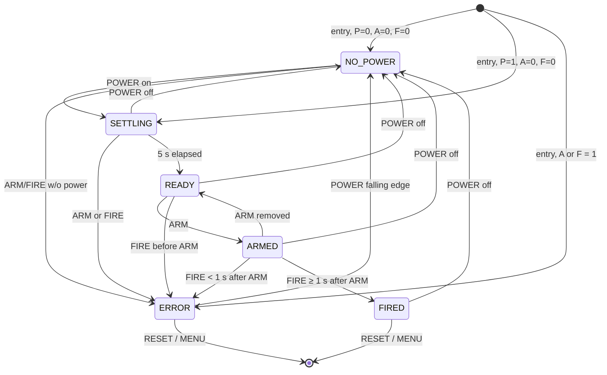

# WH Board Tester — Functional & Technical Specification

| Item | Value |
|---|---|
| Document | SPEC.md |
| Version | 0.2 |
| Date | 2026-09-14 |
| Target hardware | M5Stack CoreS3 SE (ESP32-S3, 320×240 capacitive touch LCD) |
| Toolchain | PlatformIO, Arduino framework, M5Unified / M5GFX, LVGL 9.2 |
| Firmware | v0.2.3 — implemented, builds; hardware testing in progress |
| Status | Software decisions resolved; hardware items open — see §14 |

---

## 1. Purpose & Scope

A handheld tester for the **WH Board**. The tester has two test modes, chosen from a touchscreen menu:

1. **Internal Connector mode.** The tester reads three digital outputs from the WH Board (**POWER**, **ARM**, **FIRE**). It checks them against the required sequencing rules and shows the resulting state. It drives two digital signals (**GREEN**, **RED**) back to the WH Board to show that state.
2. **External Connector mode.** The WH Board's external connector (two wires) goes to a switchable load on the tester: **OPEN CCT**, **CLOSED CCT** (short), or a **1 Ω dummy load** with current measured by an **INA219**. In 1 Ω mode the tester shows the live current and declares **FIRED** when the current stays above **1.2 A** for at least 5 ms.

Both modes must show every input and output with bright coloured indicators, plus a clear status line. The FIRED indication must look the same in both modes.

> **Safety note:** The tester is only ever a stand-in for a real initiator. The 1 Ω resistor is a dummy load. The tester must never be connected in series with, or in parallel with, a live initiator.

---

## 2. Definitions

| Term | Meaning |
|---|---|
| Asserted / HIGH | Input signal at the logic-1 level (5 V at the WH Board, ~3.3 V at the GPIO after the divider) |
| Deasserted / LOW | Input signal at 0 V |
| Debounced | Input level has been stable for `INPUT_DEBOUNCE_MS` (5 ms) |
| Toggle interval | Time between output level changes (the half-period). "Toggle at 600 ms" = 600 ms ON, 600 ms OFF |
| Tick | One pass of the I/O and state-machine task (nominally 1 ms) |
| Latch | A state that stays in place after the condition that caused it goes away |

---

## 3. Hardware

### 3.1 Controller

- M5Stack CoreS3 SE: ESP32-S3, 16 MB flash, PSRAM, 2.0" 320×240 IPS with capacitive touch, speaker, USB-C.
- The CoreS3 SE has **no physical front buttons**. All user input is through on-screen touch buttons.

### 3.2 Pin Allocation

| Signal | GPIO | Dir | Active level | Connector | Notes |
|---|---|---|---|---|---|
| POWER (from WH) | **GPIO5** | IN | HIGH | M-Bus | 5 V → 3.3 V divider, pull-down |
| ARM (from WH) | **GPIO6** | IN | HIGH | M-Bus | 5 V → 3.3 V divider, pull-down |
| FIRE (from WH) | **GPIO7** | IN | HIGH | M-Bus | 5 V → 3.3 V divider, pull-down |
| GREEN (to WH) | **GPIO8** | OUT | HIGH = ON | Port B | 3.3 V → 5 V buffer required |
| RED (to WH) | **GPIO9** | OUT | HIGH = ON | Port B | 3.3 V → 5 V buffer required |
| LOAD_TEST (Open / Test) | **GPIO17** | OUT | HIGH = load connected | Port C | Relay driver, pull-down |
| LOAD_SELECT (Short / 1 Ω) | **GPIO18** | OUT | HIGH = 1 Ω, LOW = short | Port C | Relay driver, pull-down |
| INA219 SDA | GPIO2 | I/O | — | Port A | `M5.Ex_I2C` |
| INA219 SCL | GPIO1 | OUT | — | Port A | `M5.Ex_I2C` |

All pin numbers live in a single `pins.h`. Check them against the official CoreS3 SE pin map before the PCB is laid out.

### 3.3 Digital Inputs (POWER, ARM, FIRE)

- The WH Board outputs 5 V logic, active HIGH.
- Conditioning per input (recommended):
  - Divider 10 kΩ (top) / 20 kΩ (bottom) → 3.33 V at the GPIO. The bottom resistor also serves as the pull-down, so an unconnected input reads **deasserted**.
  - Optional 100 Ω series resistor plus a BAT54S clamp to 3.3 V/GND for ESD and over-voltage protection.
- Firmware: `pinMode(pin, INPUT)`. Do not enable the internal pull-up.
- The WH Board ground must be common with tester ground.

### 3.4 Digital Outputs (GREEN, RED)

- ESP32 GPIO is 3.3 V push-pull. The WH Board expects 5 V logic.
- Recommended: a 74AHCT1G125 / 74HCT125 buffer powered from 5 V (TTL-compatible inputs accept 3.3 V as HIGH). Add a 10 kΩ pull-down on the buffer input so outputs stay OFF during reset.
- Outputs must be **LOW (OFF)** from power-up until the firmware explicitly drives them.

### 3.5 External Load Switching

The two external-connector wires go to a relay network controlled by GPIO17 and GPIO18:

| Load mode | GPIO17 (TEST) | GPIO18 (SELECT) | Circuit presented to WH Board |
|---|---|---|---|
| **OPEN CCT** (safe state: boot, menu, Internal) | LOW | LOW | Wires open |
| **CLOSED CCT** | HIGH | LOW | Wires shorted |
| **1 Ω LOAD** | HIGH | HIGH | 1 Ω resistor in series with the INA219 shunt (0.1 Ω) |
| (invalid/transitional) | LOW | HIGH | Treated as open |

- Relay drive: logic-level N-MOSFET or NPN low-side driver per coil, flyback diode, and a 10 kΩ gate/base pull-down so relays are **de-energised** when the GPIO is floating or in reset.
- **Break-before-make** in firmware (see §7.3). GPIO17 is always the last line energised and the first released.
- 1 Ω resistor: at 1.2 A it dissipates 1.44 W. Use a pulse-rated resistor of at least 5 W, or size it to the WH Board's maximum fire current and duration (see §14).

### 3.6 Output Pin Start-up Behaviour

GPIO8/9 (Port B) and GPIO17/18 (Port C) are ordinary GPIO. They are not strapping pins and not UART0, so nothing drives them during ROM boot. They float until the firmware configures them.

Required measures:
1. External pull-downs on the buffer and relay-driver inputs (§3.4, §3.5) hold them OFF while floating.
2. Set GPIO8, GPIO9, GPIO17 and GPIO18 to OUTPUT LOW as the **first** statements in `setup()`, before `M5.begin()`.
3. Build with `-DARDUINO_USB_CDC_ON_BOOT=1` so `Serial` is native USB.
4. Verification tests T-HW-02/03 (§13) confirm that no output glitches and no relay operates during power-up or reset.

### 3.7 INA219 Current Sensor

- I²C on Port A (`M5.Ex_I2C`, SDA=GPIO2, SCL=GPIO1), 400 kHz, default address `0x40` (configurable).
- Module has a standard **0.1 Ω** on-board shunt.
- Configuration:
  - PGA ÷8 → ±320 mV shunt range → **±3.2 A** full scale (1.2 A threshold = 120 mV, 37.5 % of range).
  - Shunt ADC 12-bit, 1 sample (532 µs conversion). LSB = 10 µV = **0.1 mA**.
  - Mode: shunt voltage, continuous (bus voltage not needed; read optionally at a low rate).
  - Bus voltage range: 32 V setting. The INA219 input common-mode must stay within 0–26 V.
- Firmware computes current directly: `I = V_shunt / R_SHUNT` from the Shunt Voltage register (0x01). It does not depend on the calibration register.
- Use a small direct-register driver rather than a general-purpose library. This gives full control of configuration and read timing.
- Presence check at boot and on entering External mode. The config register must read back as written.

---

## 4. System Architecture

### 4.1 Tasks

| Task | Core | Priority | Period | Responsibility |
|---|---|---|---|---|
| `ioTask` | 0 | `configMAX_PRIORITIES − 2` | 1 ms (`xTaskDelayUntil`) | Sample & debounce inputs, run the Internal state machine, drive GREEN/RED blink timing, relay sequencing, INA219 sampling & FIRED detection |
| `loop()` (UI) | 1 | Normal | ~2 ms loop; widgets refreshed every 30 ms | Touch (`M5.update()`), LVGL rendering (`lv_timer_handler()`), beeper, serial log output |

- `ioTask` owns all GPIO and `M5.Ex_I2C` (I²C port 0). The UI task never touches these directly. Touch and the speaker amplifier use the internal I²C bus (port 1), which has its own driver lock.
- Communication:
  - `ioTask` → UI: an `io::Snapshot` struct, copied under a spinlock every tick. It holds debounced inputs, driven outputs, state, error code, timers, last result, current and sensor health.
  - UI → `ioTask`: a command queue (`EnterMenu`, `EnterInternal`, `EnterExternal`, `Reset`, `SetLoad(mode)`).
  - `ioTask` → UI: an event queue (64 entries, never blocks the I/O task) for the serial log and beeper: `Screen`, `InputEdge`, `IntState`, `IntReset`, `ExtReset`, `LoadChange`, `ExtFired`, `PulseEnd`, `SensorProbe`, `SensorFault`, `SensorRecovered`.
- **Timing, blinking and FIRED detection must never depend on how fast the display renders.**
- The UI draws a screen only after the I/O task has acknowledged the screen change (`snapshot.screen == current`), so stale state is never drawn on a new screen.
- The Internal state machine (`InternalSm`) and FIRED detector (`FireDetector`) are pure logic in `lib/wh_logic`, with no hardware calls. They are unit tested (§13.4).

### 4.2 Source Layout (PlatformIO)

```
WH Tester Only/
├── platformio.ini
├── SPEC.md
├── include/
│   ├── pins.h                 // all GPIO assignments (§3.2)
│   ├── config.h               // all timing / threshold constants (§12)
│   └── lv_conf.h              // LVGL 9 configuration
├── lib/wh_logic/src/          // pure logic, shared by firmware and tests
│   ├── tester_types.h         // enums + display/log names
│   ├── internal_sm.cpp/.h     // Internal-mode state machine (§6)
│   └── fire_detect.cpp/.h     // FIRED qualification + sensor health (§7.4)
├── src/
│   ├── main.cpp               // setup(), loop()
│   ├── io_task.cpp/.h         // 1 ms task: debounce, outputs, relays, INA219
│   ├── ina219.cpp/.h          // minimal register driver
│   ├── beeper.cpp/.h          // non-blocking tones via M5.Speaker
│   ├── event_log.cpp/.h       // serial event log (§10)
│   └── ui/
│       ├── lvgl_port.cpp/.h   // LVGL display (M5GFX) + touch (M5Unified)
│       ├── widgets.cpp/.h     // Indicator, ChipStrip, StatusBanner, TapButton,
│       │                      // HoldButton, shared FIRED indication
│       ├── ui.cpp/.h          // screen manager
│       ├── screens.h
│       ├── screen_menu.cpp
│       ├── screen_internal.cpp
│       └── screen_external.cpp
└── test/
    ├── test_internal_sm/      // §13.4
    └── test_fire_detect/      // §13.4
```

### 4.3 Build Environment

| Item | Value |
|---|---|
| Platform | pioarduino `platform-espressif32` (stable), Arduino-ESP32 3.3.x |
| Board | `m5stack-cores3` (M5Unified detects CoreS3 SE at run time) |
| Libraries | M5Unified ≥ 0.2.21, M5GFX ≥ 0.2.28, LVGL 9.2.x |
| Key build flags | `-DARDUINO_USB_CDC_ON_BOOT=1`, `-DCORE_DEBUG_LEVEL=0`, `-DLV_CONF_INCLUDE_SIMPLE`, `-Iinclude` |
| Workspace | `.pio` build/library cache is placed in `%LOCALAPPDATA%/pio-workspaces/wh-tester`, so Google Drive does not sync it |
| Footprint (v0.2.0) | Flash ≈ 892 KB (13.6 %), static RAM ≈ 29 KB |

Commands:
- Build / upload: `pio run -e m5stack-cores3 -t upload`
- Serial log: `pio device monitor -e m5stack-cores3`
- Unit tests on the device: `pio test -e m5stack-cores3`
- Unit tests on a PC (needs host g++): `pio test -e native`

---

## 5. Application Flow

### 5.1 Boot Sequence

1. Drive GPIO8, GPIO9, GPIO17 and GPIO18 **LOW** (first lines of `setup()`).
2. Configure GPIO5/6/7 as inputs.
3. `M5.begin()`. Set display brightness to 100 %.
4. Start USB serial and log `BOOT` with firmware version.
5. Probe the INA219 and log the result.
6. Start `ioTask`.
7. Show the **Main Menu**.

### 5.2 Main Menu

- Title: `WH BOARD TESTER` and firmware version.
- Two large single-tap buttons, 300×74 px, 24 pt two-line text:
  - **INTERNAL CONNECTOR** (blue)
  - **EXTERNAL CONNECTOR** (purple)
- Status footer (16 pt): `Current Sensor: OK` in green / `Current Sensor: NOT FOUND` in red. It shows the most recent probe (boot, or the last External entry).
- In the menu: GREEN/RED outputs OFF, load relays OPEN CCT, no state machine running.

### 5.3 Screen Transitions

MENU and RESET on the test screens are **press-and-hold** buttons (§8.6). Menu buttons and load-select buttons are single tap.

| From | Action | Result |
|---|---|---|
| Menu | Tap INTERNAL | Outputs OFF, relays OPEN → Internal screen → entry evaluation (§6.4) |
| Menu | Tap EXTERNAL | Outputs OFF → External screen with **1 Ω LOAD selected** (relays switched break-before-make, §7.3); INA219 re-probed |
| Internal | Hold MENU 1 s | State machine stopped, FIRED/ERROR latch and LAST RESULT cleared, outputs OFF → Menu |
| External | Hold MENU 1 s | Relays → OPEN CCT (break-before-make), FIRED latch cleared → Menu |

---

## 6. Internal Connector Mode

### 6.1 States

| # | State | Display text |
|---|---|---|
| S0 | `NO_POWER` | NO POWER |
| S1 | `SETTLING` | POWER ON / SETTLING *n* |
| S2 | `READY` | READY |
| S3 | `ARMED` | ARMED |
| S4 | `FIRED` | FIRED |
| S5 | `ERROR` | ERROR + reason |

### 6.2 Error Codes

| Code | Display reason | Cause |
|---|---|---|
| `E_ARM_NO_POWER` | ARM WITHOUT POWER | ARM asserted while POWER deasserted |
| `E_FIRE_NO_POWER` | FIRE WITHOUT POWER | FIRE asserted while POWER deasserted |
| `E_ARM_SETTLING` | ARM DURING SETTLING | ARM asserted during SETTLING |
| `E_FIRE_SETTLING` | FIRE DURING SETTLING | FIRE asserted during SETTLING |
| `E_FIRE_BEFORE_ARM` | FIRE BEFORE ARM | FIRE asserted in READY (ARM not asserted), or ARM and FIRE asserted on the same tick |
| `E_FIRE_TOO_SOON` | FIRE < 1 s AFTER ARM (shows *xxx* ms) | FIRE asserted less than `ARM_TO_FIRE_MIN_MS` after entering ARMED |
| `E_SIGNAL_ON_ENTRY` | ARM/FIRE ACTIVE ON ENTRY | ARM or FIRE already asserted when the screen is entered or RESET is pressed, with POWER present |

If ERROR is entered with POWER deasserted, the NO_POWER codes are used.

### 6.3 Evaluation Rules

- All rules use **debounced** input levels (5 ms).
- Within one tick, rules are evaluated in the order given in the transition table. The first matching row wins.
- **Power-loss grace window** (`POWER_LOSS_GRACE_MS`, default 50 ms). When POWER goes LOW, the WH Board may take a moment to drop ARM/FIRE as well. ARM/FIRE still asserted within this window after the POWER falling edge do not cause `E_*_NO_POWER`. After the window closes, the no-power rules apply as normal. The window does not apply to entry evaluation.
- **LAST RESULT.** Entering FIRED or ERROR records the result, its error code and time. The record survives power loss and later power cycles, and stays on screen (§8.3) until **RESET** or **MENU**. A later FIRED/ERROR replaces it.

### 6.4 Entry Evaluation

Runs on entering the Internal screen and on **RESET**. Both also clear the LAST RESULT record first:

| POWER | ARM | FIRE | Next state |
|---|---|---|---|
| LOW | LOW | LOW | NO_POWER |
| LOW | any HIGH | | ERROR (`E_ARM_NO_POWER` / `E_FIRE_NO_POWER`) |
| HIGH | LOW | LOW | SETTLING (countdown restarts at 5) |
| HIGH | any HIGH | | ERROR (`E_SIGNAL_ON_ENTRY`) |

### 6.5 Transition Table

| From | Condition (in priority order) | To | Action |
|---|---|---|---|
| NO_POWER | ARM HIGH (POWER LOW, outside grace window) | ERROR | `E_ARM_NO_POWER` |
| NO_POWER | FIRE HIGH (POWER LOW, outside grace window) | ERROR | `E_FIRE_NO_POWER` |
| NO_POWER | POWER HIGH, ARM LOW, FIRE LOW | SETTLING | start 5 s timer |
| NO_POWER | POWER HIGH and (ARM or FIRE HIGH) | ERROR | `E_ARM_SETTLING` / `E_FIRE_SETTLING` |
| SETTLING | POWER LOW | NO_POWER | cancel timer |
| SETTLING | ARM HIGH | ERROR | `E_ARM_SETTLING` |
| SETTLING | FIRE HIGH | ERROR | `E_FIRE_SETTLING` |
| SETTLING | 5000 ms elapsed | READY | |
| READY | POWER LOW | NO_POWER | |
| READY | FIRE HIGH (incl. ARM+FIRE same tick) | ERROR | `E_FIRE_BEFORE_ARM` |
| READY | ARM HIGH, FIRE LOW | ARMED | record `t_armed` |
| ARMED | POWER LOW | NO_POWER | |
| ARMED | FIRE HIGH and `now − t_armed < 1000 ms` | ERROR | `E_FIRE_TOO_SOON` (log measured ms) |
| ARMED | FIRE HIGH and `now − t_armed ≥ 1000 ms` | FIRED | record `t_fired`, beep, log |
| ARMED | ARM LOW, FIRE LOW | READY | log `DISARMED` |
| FIRED | POWER LOW | NO_POWER | FIRED state cleared; LAST RESULT: FIRED stays on screen |
| FIRED | RESET button | Entry evaluation (§6.4) | |
| FIRED | any ARM/FIRE activity with POWER HIGH | FIRED (no change) | latched |
| ERROR | POWER **falling edge** (HIGH→LOW) | NO_POWER | ERROR state cleared; LAST RESULT stays on screen (then §6.5 NO_POWER rules apply) |
| ERROR | RESET button | Entry evaluation (§6.4) | |
| ERROR | any other input change | ERROR (no change) | latched; first error code is kept |
| any | MENU button | (leave screen) | outputs OFF |

Notes:
- FIRE is checked before ARM-LOW in ARMED, so a FIRE that arrives on the same tick ARM drops is still treated as a fire.
- `now − t_armed` is measured between debounced edges. Both edges carry the same 5 ms debounce delay, so it cancels out.
- ERROR clears on a POWER *falling edge*, not on POWER being LOW. This stops an error raised with no power (e.g. `E_ARM_NO_POWER`) from clearing itself straight away.

### 6.6 State Diagram



### 6.7 Output (GREEN / RED) Behaviour

| State | GREEN (GPIO8) | RED (GPIO9) |
|---|---|---|
| NO_POWER | OFF | OFF |
| SETTLING | Toggle every **600 ms** | OFF |
| READY | Toggle every **166 ms** | OFF |
| ARMED | OFF | **ON** (steady) |
| FIRED | OFF | OFF |
| ERROR | Toggle every **100 ms** | Toggle every **100 ms**, in phase with GREEN |

- On entering a blinking state, the blink phase restarts with the output **ON**.
- Blink timing is generated in `ioTask` from `millis()`/`esp_timer`, accurate to ±5 ms. It is not affected by UI load.
- The on-screen GREEN/RED indicators show the **actual driven pin level**, so they blink in step with the real outputs.
- Outputs are forced OFF outside the Internal screen.

### 6.8 Settling Countdown

- On-screen countdown `5 → 4 → 3 → 2 → 1` (ceil of seconds remaining), updated at least every 100 ms.
- Countdown restarts from 5 each time SETTLING is entered.

---

## 7. External Connector Mode

### 7.1 Status Values

| Status | Display text | Meaning |
|---|---|---|
| `EXT_OPEN` | OPEN CCT | Wires open |
| `EXT_CLOSED` | CLOSED CCT | Wires shorted |
| `EXT_1R_MONITOR` | 1 Ω LOAD — MONITORING | 1 Ω load connected, FIRED detection active |
| `EXT_SWITCHING` | SWITCHING… | Relay sequence in progress (≤ 100 ms) |
| `EXT_FIRED` | FIRED | Current ≥ 1.2 A for ≥ 5 ms. Held while current stays ≥ 1.2 A and for 5 s after it drops, then cleared to a LAST RESULT |
| `EXT_SENSOR_FAULT` | SENSOR FAULT | INA219 absent or I²C errors while in 1 Ω mode |

### 7.2 Behaviour

- Entering External mode: load = **1 Ω LOAD** (`EXTERNAL_DEFAULT_LOAD`), FIRED latch clear. The relays switch from OPEN using the §7.3 sequence, so FIRED detection is armed about 90 ms after entry. Relays return to OPEN CCT when leaving the screen.
- Operator selects **OPEN CCT / CLOSED CCT / 1 Ω LOAD** with on-screen buttons. The selected button is highlighted.
- GREEN/RED outputs are held **OFF**. POWER/ARM/FIRE are neither evaluated nor displayed in this mode (confirmed).
- FIRED detection runs **only in 1 Ω LOAD mode** (confirmed; not in CLOSED CCT).
- Once FIRED:
  - The shared FIRED indication is shown (§8.4) for as long as the current stays ≥ 1.2 A.
  - When the current drops below 1.2 A (or monitoring stops, e.g. load changed or a failed read), a **5 s hold** (`EXT_FIRED_HOLD_MS`) starts. The banner detail shows `Peak x.xx A - clears in n s`. If the current returns to ≥ 1.2 A during the hold, the hold is cancelled and restarts when it drops again. This does not count as a new firing.
  - When the hold expires, FIRED **clears the same way as the Internal screen after power loss**. The status returns to the live load mode, and a yellow **`LAST RESULT: FIRED n s ago`** strip is shown with the FIRED chip outlined until **RESET** or **MENU**.
  - After clearing, detection is live again: a new qualifying pulse gives a new FIRED (and explosion sound).
  - The load selection is **not** changed automatically. The operator may still change it.
- RESET (or MENU): clears FIRED, the LAST RESULT and the peak current immediately. Status returns to the current load mode.

### 7.3 Load Switching Sequence (non-blocking, in `ioTask`)

1. Drive GPIO17 LOW (disconnect). Status = SWITCHING.
2. Wait `RELAY_RELEASE_MS` (20 ms).
3. Set GPIO18 to the target (HIGH for 1 Ω, LOW for short/open).
4. Wait `RELAY_SETTLE_MS` (20 ms).
5. If the target is not OPEN, drive GPIO17 HIGH.
6. Wait `DETECT_BLANKING_MS` (50 ms) before FIRED detection is armed, so contact bounce is not read as current.
7. Status = target mode.

If a new selection arrives mid-sequence, the sequence restarts from step 1.

### 7.4 FIRED Detection (1 Ω mode)

- The INA219 shunt register is polled at **≥ 1 kHz**, one read per `ioTask` tick.
- Algorithm:
  ```
  above = read_ok and detect_enabled and I >= FIRE_CURRENT_A
  if above:
      if not above_active: above_active = true; above_start = now_us; samples_above = 0
      samples_above += 1
      if not fired and samples_above >= FIRE_MIN_SAMPLES
                   and now_us - above_start >= FIRE_QUALIFY_MS*1000:
          latch FIRED
  elif above_active:
      above_active = false   # pulse ended: record duration and peak
  ```
  - `FIRE_CURRENT_A` = 1.200 A (a reading exactly at the threshold counts as above), `FIRE_QUALIFY_MS` = 5 ms, `FIRE_MIN_SAMPLES` = 4.
  - A single sample below the threshold, or a failed read, restarts qualification (no hysteresis on qualification).
  - `detect_enabled` is true only when the 1 Ω load is selected **and** the relay sequence (including blanking) is complete. Changing the load also abandons any qualification in progress.
- Sensor health: 3 consecutive failed reads → `EXT_SENSOR_FAULT`. Recovery (and re-writing the INA219 configuration) is automatic after 10 consecutive good reads. While faulted, reads are retried every 100 ms (`SENSOR_RETRY_MS`), so a missing device cannot stall the 1 ms loop. A FIRED status (including its 5 s hold) takes display priority over SENSOR FAULT. While faulted, the hold clears on the next retry read, so up to 100 ms late.
- **Peak current** (max |I| since RESET or External entry) is shown on the FIRED detail line. **Peak and time above threshold** of the firing pulse are logged when it ends (§10).

### 7.5 Current Display

- Large numeric readout, `0.000 A` (32 pt), averaged over the last 50 good samples (~50 ms), refreshed every 30 ms.
- Colour: white while monitoring, red at or above 1.2 A, and dimmed grey in OPEN / CLOSED modes, where the live value is still shown and the banner reads "Monitoring inactive".
- A horizontal bar graph from 0 to 2.0 A with a white marker at the 1.2 A threshold. The bar turns red at or above the threshold.
- When the sensor is absent or faulted, the readout shows `-.--- A` in grey and the bar is empty.

---

## 8. User Interface

### 8.1 General

- Display 320×240 landscape, brightness 100 %, black background (`#000000`) for maximum contrast.
- Built with **LVGL 9.2**. M5GFX is the display driver (partial rendering, 80-line buffer, RGB565 pushed with `pushImage`) and M5Unified supplies touch.
- **Large text for a 2" screen.** Montserrat fonts: 28 pt status, 32 pt current value, 24 pt buttons, 20 pt indicator values, 16 pt titles, 12–14 pt only for chips and detail lines.
- **Large touch targets.** Test-screen buttons are at least 104×40 px, MENU/RESET 157×54 px, and menu buttons 300×74 px.
- Indicators use **bright saturated colours when active** and dark grey (`#303030`) with grey text when inactive. Every indicator also shows a text state (`ON`/`OFF`, `1 OHM`/`SHORT`), so it can be read without relying on colour.
- Press feedback: tap buttons show a thick white border while pressed, and every press gives a short click from the speaker.
- Widgets are refreshed from the snapshot every 30 ms, but LVGL is only touched when a value actually changes. This keeps redraws minimal and flicker-free.
- Fonts contain ASCII plus LVGL symbols only, so on-screen text writes "1 OHM" (not Ω) and ">=" (not ≥).

### 8.2 Colour Palette

| Use | Colour |
|---|---|
| POWER indicator ON | Bright green `#00FF00` |
| ARM indicator ON | Bright orange `#FF8C00` |
| FIRE indicator ON | Bright red `#FF0000` |
| GREEN output ON | Bright green `#00FF00` |
| RED output ON | Bright red `#FF0000` |
| Relay/load indicator ON | Cyan `#00E5FF` |
| Status NO_POWER | Grey `#606060` bg, white text |
| Status SETTLING | Amber `#FFB000` bg, black text |
| Status READY | Green `#00C000` bg, black text |
| Status ARMED | Orange `#FF6000` bg, black text |
| Status FIRED | Flashing red `#FF0000` / yellow `#FFFF00`, contrasting text |
| Status ERROR | Red `#C00000` bg, white text (flashing at 2 Hz) |
| External OPEN / CLOSED / 1 Ω | Blue `#0060FF` / Magenta `#FF00FF` / Cyan `#00E5FF` bg |

### 8.3 Internal Screen Layout (320×240)

No header bar. The mode tag ("INT") sits in the banner corner, which frees height for larger text.

```
y    0 ┌────────┬────────┬────────┬────────┬────────┬────────┐
       │ NO PWR │ SETTLE │ READY  │ ARMED  │ FIRED  │ ERROR  │ chip strip, 12 pt      (20)
    22 ├────────┴────────┴────────┴────────┴────────┴────────┤
       │INT              POWER ON  3              (28 pt)    │ status banner          (52)
       │           Settling - READY in 3 s        (14 pt)    │
    78 ├─────────────────┬─────────────────┬─────────────────┤
       │      POWER      │       ARM       │      FIRE       │ input tiles 16/20 pt   (54)
       │       ON        │       OFF       │       OFF       │
   136 ├─────────────────┴───────┬─────────┴─────────────────┤
       │ GREEN                ON │ RED                   OFF │ output tiles, 20 pt    (40)
   182 ├─────────────────────────┼───────────────────────────┤
       │          MENU           │          RESET            │ hold buttons, 24 pt    (56)
       │        HOLD 1 s         │        HOLD 1 s           │
   240 └─────────────────────────┴───────────────────────────┘
```

- **Chip strip** (the "line showing the current status"): six state chips. The current state is filled in its status colour. When a LAST RESULT is showing, that result's chip (FIRED or ERROR) gets a **yellow outline**.
- **Status banner** (main text / detail line):

  | State | Main (28 pt) | Detail (14 pt) | Colours |
  |---|---|---|---|
  | NO_POWER | `NO POWER` | `Apply POWER` | grey / white |
  | SETTLING | `POWER ON  n` | `Settling - READY in n s` | amber / black |
  | READY | `READY` | `Waiting for ARM` | green / black |
  | ARMED | `ARMED` | `Armed x.x s - wait before FIRE`, then from 1.0 s `Armed x.x s - FIRE allowed` | orange / black |
  | FIRED | `⚠ FIRED ⚠` | `Fired n s ago` | shared FIRED indication (§8.4) |
  | ERROR | `ERROR` | reason from §6.2; for too-soon, `FIRE nnn ms AFTER ARM (< 1 s)` | red flashing 2 Hz (`#C00000`/`#500000`) / white |

- **LAST RESULT line.** While a recorded FIRED/ERROR is not the live state, the detail line changes to a **yellow-on-black strip**: `LAST RESULT: FIRED n s ago` or `LAST: <error reason>`. It stays until RESET or MENU.
- Output tiles show the **actual pin level**, so they blink in step with GPIO8/9.
- **RESET** is enabled in FIRED, in ERROR, or while a LAST RESULT is showing. Otherwise it is greyed out and ignores presses.

### 8.4 Shared FIRED Indication (both screens)

One shared implementation (`ui::fired` in `widgets.cpp`) is used identically by both screens:

1. The status banner shows **`⚠ FIRED ⚠`** (28 pt), flashing every **250 ms** between red background/yellow text and yellow background/red text.
2. A **6 px border around the whole screen** (on LVGL's top layer) flashes in the same colours, in phase.
3. Detail line: `Fired n s ago` (Internal) / `Fired n s ago - peak x.xx A` (External).
4. The FIRED chip in the strip flashes in the same colours.
5. The explosion sound plays once on entry (§9).
6. The border does not take touches, and all input/output/current indicators stay visible and live.

### 8.5 External Screen Layout (320×240)

```
y    0 ┌──────────┬──────────┬──────────┬──────────┬──────────┐
       │   OPEN   │  CLOSED  │  1 OHM   │  FIRED   │  FAULT   │ status chips, 12 pt  (20)
    22 ├──────────┴──────────┴──────────┴──────────┴──────────┤
       │EXT              1 OHM LOAD                (28 pt)    │ status banner        (52)
       │          FIRES at >= 1.20 A for 5 ms      (14 pt)    │
    78 ├──────────────────────────────────────────────────────┤
       │ I =                                  0.842 A (32 pt) │ current readout      (40)
   122 │[██████████████████████████|░░░░░░░░░░░░░░░░░░░░░░░░░]│ bar 0–2 A, 1.2 A mark(14)
   140 ├─────────────────┬─────────────────┬──────────────────┤
       │      OPEN       │     CLOSED      │      1 OHM       │ load select, 20 pt   (40)
   184 ├─────────────────┴───────┬─────────┴──────────────────┤
       │          MENU           │          RESET             │ hold buttons, 24 pt  (54)
       │        HOLD 1 s         │        HOLD 1 s            │
   240 └─────────────────────────┴────────────────────────────┘
```

| Status | Main | Detail | Chip / colours |
|---|---|---|---|
| OPEN CCT | `OPEN CCT` | `Monitoring inactive` | OPEN, blue / white |
| CLOSED CCT | `CLOSED CCT` | `Monitoring inactive` | CLOSED, magenta / black |
| 1 Ω monitoring | `1 OHM LOAD` | `FIRES at >= 1.20 A for 5 ms` | 1 OHM, cyan / black |
| Switching | `SWITCHING` | `Relays changing...` | selected load chip outlined, grey |
| Sensor fault | `SENSOR FAULT` | `Check INA219 on Port A` | FAULT, red / white; load chip outlined |
| FIRED (current ≥ 1.2 A) | `⚠ FIRED ⚠` | `Fired n s ago - peak x.xx A` | FIRED flashing (§8.4); load chip outlined |
| FIRED (5 s hold after current lost) | `⚠ FIRED ⚠` | `Peak x.xx A - clears in n s` | FIRED flashing (§8.4); load chip outlined |
| After hold (any load mode) | load mode text | yellow-on-black `LAST RESULT: FIRED n s ago` | load colours; FIRED chip outlined yellow |

- The selected load button is filled in its mode colour. Load buttons are single tap.
- Relay output levels (GPIO17/18) are **not** shown as separate indicators; the selected load button and status banner show the load state (removed in v0.2.1 as not required).
- RESET is enabled while FIRED is shown or a LAST RESULT is showing.

### 8.6 Press-and-Hold Buttons

- RESET must be **held for 1 s** (`HOLD_BUTTON_MS`), so a stray tap cannot abort a test. MENU acts immediately on press (no hold, no "HOLD 1 s" hint).
- While RESET is held, it fills left-to-right with its red accent colour. The action fires once when the fill completes.
- Releasing early, or sliding off the button, cancels the hold and clears the fill.
- The label reads `HOLD 1 s` under the button name.

---

## 9. Audio (Speaker)

Non-blocking, using `M5.Speaker`, volume configurable (`BEEP_VOLUME`, default 200/255).

| Event | Sound |
|---|---|
| FIRED (both modes) | **Explosion sample** — `src/assets/boom_pcm.cpp` (from `mixkit-fuel-explosion-1705.wav`, 16-bit mono, 16 kHz, 19 200 samples ≈ 1.2 s), played with `M5.Speaker.playRaw()` on speaker channel 0. It interrupts any sound already playing. |
| ERROR entry | 3 × (800 Hz, 100 ms on / 100 ms off) |
| Touch button press | 2000 Hz, 20 ms click, suppressed while the explosion or an ERROR pattern is playing |

Sounds play once per event and do not repeat while the state is latched. The PCM asset is generated by `tools/wav_to_pcm.py` and must not be edited by hand (≈ 38 KB flash).

---

## 10. Serial Event Log

- USB CDC `Serial`, 115200 baud, line-oriented ASCII. Events are passed from `ioTask` through a queue, so logging never blocks `ioTask`.
- **Logging must never block the UI either.** When the CoreS3 is plugged into a PC but no terminal is reading the port, the CDC transmit buffer fills. A normal blocking write then waits up to ~2 s per call (20 × 100 ms tx timeout), which froze touch response on both screens in v0.2.0. From v0.2.1:
  - The tx timeout is set to 0 (`Serial.setTxTimeoutMs(0)`).
  - Each line is formatted into one buffer and written with a single `Serial.write()`, only if `Serial.availableForWrite()` has room for the whole line.
  - Lines that don't fit are dropped and counted. When space returns, a `SYS LOG_DROPPED n` line is written first.
- Format: `[<ms since boot, 8 digits>] <MODE> <EVENT> <details>`

Examples:
```
[00000012] SYS  BOOT fw=0.1.0 ina219=OK addr=0x40
[00003400] SYS  SCREEN INTERNAL
[00003401] INT  STATE NO_POWER
[00003401] INT  STATE NO_POWER (entry)
[00005120] INT  IN POWER=1
[00005120] INT  STATE NO_POWER -> SETTLING
[00010120] INT  STATE SETTLING -> READY
[00012300] INT  IN ARM=1
[00012300] INT  STATE READY -> ARMED
[00012950] INT  IN FIRE=1
[00012950] INT  STATE ARMED -> ERROR code=E_FIRE_TOO_SOON arm_to_fire=650ms
[00015000] INT  RESET
[00015000] INT  STATE SETTLING (entry)
[00020000] SYS  SCREEN EXTERNAL
[00020001] EXT  LOAD OPEN
[00020001] EXT  INA219 probe=OK addr=0x40
[00022000] EXT  LOAD 1R
[00024511] EXT  FIRED i=1.430A qualify=5ms
[00024530] EXT  PULSE_END peak=1.520A above_thr=19ms
[00029530] EXT  FIRED_CLEARED hold=5000ms (last result kept)
[00030000] EXT  SENSOR_FAULT i2c_err=3
[00031200] EXT  SENSOR_OK
```

Logged events: boot, screen changes, every debounced input edge (Internal), every state transition with error code, arm-to-fire interval, RESET, load changes, FIRED (with qualifying current), pulse end (peak current and time above threshold), sensor faults and recoveries.

---

## 11. Non-Functional Requirements

| ID | Requirement |
|---|---|
| NF-01 | Input sampling period ≤ 1 ms; debounce 5 ms; state-change latency ≤ 10 ms after the raw edge |
| NF-02 | Blink toggle timing accuracy ±5 ms; SETTLING and ARM→FIRE timers accuracy ±10 ms |
| NF-03 | INA219 sampled at ≥ 1 kHz in 1 Ω mode; FIRED declared within 10 ms of qualification being met |
| NF-04 | LVGL refresh period 20 ms, widgets updated from the snapshot every 30 ms; indicator reflects a pin change within 100 ms |
| NF-05 | Outputs (GPIO8/9) and relays (GPIO17/18) must not glitch HIGH during power-up, reset, brown-out or firmware upload |
| NF-06 | Watchdog (task WDT) enabled on `ioTask`. On watchdog reset all outputs start OFF and relays OPEN |
| NF-07 | No heap allocation in `ioTask` after start-up |
| NF-08 | All timing/threshold constants are defined only in `config.h` |
| NF-09 | Firmware version string shown on the menu and logged at boot |
| NF-10 | Nothing in the UI loop may block for more than a few milliseconds (no blocking serial writes or I²C waits); touch feedback within 100 ms |

---

## 12. Configuration Constants (`config.h`)

| Constant | Default | Unit |
|---|---|---|
| `INPUT_DEBOUNCE_MS` | 5 | ms |
| `SETTLING_TIME_MS` | 5000 | ms |
| `ARM_TO_FIRE_MIN_MS` | 1000 | ms |
| `POWER_LOSS_GRACE_MS` | 50 | ms |
| `BLINK_SETTLING_MS` | 600 | ms (toggle interval) |
| `BLINK_READY_MS` | 166 | ms |
| `BLINK_ERROR_MS` | 100 | ms |
| `FIRED_FLASH_MS` | 250 | ms |
| `FIRE_CURRENT_A` | 1.200 | A |
| `FIRE_QUALIFY_MS` | 5 | ms |
| `FIRE_MIN_SAMPLES` | 4 | samples |
| `EXT_FIRED_HOLD_MS` | 5000 | ms (External FIRED hold after current is lost) |
| `R_SHUNT_OHMS` | 0.100 | Ω |
| `INA219_ADDR` | 0x40 | — |
| `INA219_I2C_HZ` | 400000 | Hz |
| `SENSOR_FAIL_COUNT` | 3 | reads |
| `SENSOR_RECOVER_COUNT` | 10 | reads |
| `RELAY_RELEASE_MS` | 20 | ms |
| `RELAY_SETTLE_MS` | 20 | ms |
| `DETECT_BLANKING_MS` | 50 | ms |
| `EXTERNAL_DEFAULT_LOAD` | `LoadMode::OneOhm` | load selected on entering External |
| `SENSOR_RETRY_MS` | 100 | ms (read retry while faulted) |
| `CURRENT_AVG_SAMPLES` | 50 | samples (display average) |
| `ERROR_FLASH_MS` | 250 | ms (ERROR banner flash) |
| `HOLD_BUTTON_MS` | 1000 | ms |
| `UI_REFRESH_MS` | 30 | ms |
| `CURRENT_BAR_MAX_A` | 2.0 | A |
| `BEEP_VOLUME` | 200 | 0–255 |
| `DISPLAY_BRIGHTNESS` | 255 | 0–255 |
| `IO_TASK_WDT_MS` | 2000 | ms (used if the task WDT is not already running) |

Signal polarity is fixed: all inputs and outputs are active HIGH (§3.2). Pin numbers are in `include/pins.h`.

---

## 13. Verification & Acceptance Tests

Internal tests use a signal generator or a small "WH Board simulator" (for example a second ESP32 driving POWER/ARM/FIRE at 5 V). Timing is checked with a logic analyser on GPIO5–9.

### 13.1 Hardware / Start-up

| ID | Procedure | Expected |
|---|---|---|
| T-HW-01 | Power up with nothing connected | Menu shown; GPIO8/9/17/18 LOW; inputs read OFF |
| T-HW-02 | Scope GPIO8/9 through 20 power cycles and 20 resets | No HIGH pulse > 1 ms |
| T-HW-03 | Scope relay coil drive on GPIO17/18 during power-up, reset and USB upload | No relay operation |
| T-HW-04 | Boot with INA219 disconnected | Menu shows `Current Sensor: NOT FOUND`; External 1 Ω mode shows SENSOR FAULT |

### 13.2 Internal Mode

| ID | Sequence | Expected state / outputs |
|---|---|---|
| T-INT-01 | Enter with all inputs LOW | NO_POWER; G OFF, R OFF |
| T-INT-02 | Apply POWER | SETTLING; countdown 5→1; GREEN toggles every 600 ms ±5 |
| T-INT-03 | Wait 5 s | READY at 5000 ±10 ms; GREEN toggles every 166 ms ±5 |
| T-INT-04 | Remove POWER during SETTLING | NO_POWER; outputs OFF |
| T-INT-05 | Remove POWER in READY | NO_POWER |
| T-INT-06 | In READY assert ARM | ARMED; GREEN OFF, RED steady ON |
| T-INT-07 | In ARMED remove ARM | READY |
| T-INT-08 | ARMED, assert FIRE 1100 ms after ARM | FIRED; both outputs OFF; FIRED indication + beep |
| T-INT-09 | ARMED, assert FIRE 900 ms after ARM | ERROR `E_FIRE_TOO_SOON`; both toggle 100 ms in phase |
| T-INT-10 | ARMED, FIRE at 995 ms and at 1005 ms (boundary) | ERROR / FIRED respectively |
| T-INT-11 | READY, assert FIRE (no ARM) | ERROR `E_FIRE_BEFORE_ARM` |
| T-INT-12 | READY, assert ARM and FIRE together | ERROR `E_FIRE_BEFORE_ARM` |
| T-INT-13 | NO_POWER, assert ARM | ERROR `E_ARM_NO_POWER` |
| T-INT-14 | NO_POWER, assert FIRE | ERROR `E_FIRE_NO_POWER` |
| T-INT-15 | SETTLING, assert ARM | ERROR `E_ARM_SETTLING` |
| T-INT-16 | Enter screen with POWER + ARM already HIGH | ERROR `E_SIGNAL_ON_ENTRY` |
| T-INT-17 | FIRED, remove POWER | NO_POWER; FIRED indication cleared |
| T-INT-18 | FIRED, hold RESET 1 s with POWER on, ARM/FIRE LOW | SETTLING (countdown restarts) |
| T-INT-19 | ERROR (with POWER), remove POWER | NO_POWER |
| T-INT-20 | ERROR via `E_ARM_NO_POWER`, keep POWER LOW | Stays ERROR (does not self-clear) |
| T-INT-21 | ARMED, drop POWER then ARM 20 ms later | NO_POWER (no error — inside grace window) |
| T-INT-22 | ARMED, drop POWER, keep ARM HIGH > 50 ms | NO_POWER → ERROR `E_ARM_NO_POWER` |
| T-INT-23 | 3 ms glitch on ARM in READY | No state change (debounce) |
| T-INT-24 | FIRED/ERROR, hold MENU 1 s, then re-enter | Latch and LAST RESULT cleared; entry evaluation applies |
| T-INT-25 | Check indicators blink in step with the logic analyser on GPIO8/9 | Screen matches pins within 100 ms |
| T-INT-26 | FIRED, then remove POWER | NO_POWER; yellow `LAST RESULT: FIRED n s ago` strip; FIRED chip outlined; RESET enabled |
| T-INT-27 | After T-INT-26, power up again and wait for READY | LAST RESULT strip still shown until RESET is held |
| T-INT-28 | ARMED, error with POWER present, then remove POWER | NO_POWER with `LAST: <reason>` strip |

### 13.2a User Interface

| ID | Procedure | Expected |
|---|---|---|
| T-UI-01 | Quick tap (< 1 s) on MENU or RESET | No action; fill bar resets on release |
| T-UI-02 | Hold MENU; slide finger off before 1 s | No action |
| T-UI-03 | Hold RESET 1 s while it is greyed out | No action |
| T-UI-04 | Hold RESET 1 s in FIRED | Fill completes, action fires once, click beep on press |
| T-UI-05 | Read every screen at arm's length (~50 cm) | Status, input/output states and current are legible |

### 13.3 External Mode

| ID | Procedure | Expected |
|---|---|---|
| T-EXT-01 | Enter External | 1 OHM LOAD selected; GPIO18 HIGH ≥ 20 ms after entry, then GPIO17 HIGH ≥ 20 ms later; meter: ≈ 1.1 Ω. Select OPEN → GPIO17/18 LOW, meter: open |
| T-EXT-02 | Select CLOSED CCT | 17 HIGH, 18 LOW; meter: < 0.5 Ω |
| T-EXT-03 | Select 1 Ω LOAD | 17 HIGH, 18 HIGH; meter: ≈ 1.1 Ω |
| T-EXT-04 | Logic analyser on 17/18 while changing modes | 17 released ≥ 20 ms before 18 changes; 17 re-energised ≥ 20 ms after |
| T-EXT-05 | 1 Ω mode, bench supply 1.00 A steady | Displays 1.00 A ±2 %; no FIRED |
| T-EXT-06 | 1 Ω mode, 1.5 A pulse of 3 ms | No FIRED |
| T-EXT-07 | 1 Ω mode, 1.5 A pulse of 8 ms | FIRED latched within 10 ms of 5 ms point; FIRED indication + beep; log shows peak |
| T-EXT-08 | 1.5 A with 1 ms dropouts to 0.5 A every 3 ms | No FIRED (qualification resets) |
| T-EXT-09 | FIRED with current still flowing, change load mode | FIRED remains during the relay change and 5 s hold, then clears to LAST RESULT |
| T-EXT-10 | FIRED, hold RESET 1 s | FIRED/LAST RESULT cleared immediately; status = current load mode |
| T-EXT-15 | 1 Ω mode: 1.5 A for 2 s, then 0 A | FIRED for the 2 s; detail counts `clears in 5…1 s`; FIRED clears 5.0 s ±0.1 s after the drop; yellow LAST RESULT strip + outlined FIRED chip remain; RESET enabled |
| T-EXT-16 | During the hold, restore 1.5 A for 1 s, then 0 A | Countdown cancelled, restarts after the second drop; no second explosion sound |
| T-EXT-17 | After T-EXT-15 clears, apply another 1.5 A 10 ms pulse | New FIRED with explosion sound |
| T-EXT-11 | Unplug INA219 in 1 Ω mode | SENSOR FAULT within 10 ms; replug → recovers within ~110 ms |
| T-EXT-12 | Hold MENU 1 s in 1 Ω mode | GPIO17 LOW immediately, GPIO18 LOW 20 ms later |
| T-EXT-13 | Compare FIRED indication visually with T-INT-08 | Identical banner, border flash, timing and beep |
| T-EXT-14 | OPEN / CLOSED modes with current flowing | Value shown dimmed; banner `Monitoring inactive`; no FIRED at any current |

### 13.4 Unit Tests

Located in `test/`. Each test file runs either on a PC (`pio test -e native`, needs a host g++) or on the CoreS3 itself (`pio test -e m5stack-cores3`, results over USB serial).

| Suite | Tests | Covers |
|---|---|---|
| `test_internal_sm` | 26 | T-INT-01…22 logic, arm→fire boundary (999/1000 ms), blink phases, grace window, LAST RESULT persistence, error-code latching |
| `test_fire_detect` | 18 | T-EXT-05…08, exact-threshold, failed read / relay-change restarts, pulse peak & duration, 5 s FIRED hold (exact boundary, restart on current return, re-fire after clear, last result), reset, sensor fault & recovery counts |

Status (v0.2.0): both suites **compile** for the CoreS3. They have **not yet been run**, because no host compiler was available in the development environment and no device was attached.

---

## 14. Decisions & Open Items

### 14.1 Resolved

| # | Item | Decision |
|---|---|---|
| 1 | Power loss right after FIRED would clear the indication | State goes to NO_POWER, but a **LAST RESULT** strip (FIRED or error reason) stays until RESET/MENU (§6.3, §8.3) |
| 2 | Meaning of "toggle at N ms" | Half-period: N ms ON, N ms OFF |
| 3 | RED/GREEN in ERROR | Blink **in phase** (both ON together) |
| 4 | Power-loss grace window | 50 ms, configurable (`POWER_LOSS_GRACE_MS`) |
| 5 | Repeated FIRE in ARMED/FIRED | First valid FIRE latches FIRED; later activity ignored |
| 6 | FIRED detection in CLOSED CCT | No — 1 Ω mode only |
| 7 | POWER/ARM/FIRE on External screen | Not shown; GREEN/RED held OFF |
| 12 | RESET with POWER present and ARM/FIRE still HIGH | ERROR `E_SIGNAL_ON_ENTRY` |
| 13 | Display sleep | Never dims or sleeps |
| 14 | UI library | LVGL 9.2 on M5GFX (§8.1) |
| 15 | Internal layout | Keep the 6-chip state strip; no header bar (§8.3) |
| 16 | Accidental-touch protection | MENU and RESET are hold-for-1-s buttons (§8.6) |

### 14.2 Still Open (hardware)

| # | Item | Current assumption |
|---|---|---|
| 8 | WH Board maximum fire current and duration, for sizing the 1 Ω resistor and relay contacts | TBD — assume ≤ 3 A, ≤ 100 ms |
| 9 | External connector voltage relative to tester ground (must be within INA219 0–26 V common mode) | TBD — assume WH ground common with tester |
| 10 | 5 V supply for the output buffers and relay coils — from the WH Board, USB, or a separate supply? | TBD |
| 11 | Confirm GPIO5/6/7 are free on the CoreS3 SE bus. GPIO8/9 (Port B) and GPIO17/18 (Port C) match M5Unified's CoreS3 SE port tables. | Assumed free — verify on hardware |
| 17 | On-device verification: unit tests (§13.4) and the acceptance tests (§13.1–13.3) have not yet been run | Pending hardware |

---

## 15. Revision History

| Version | Date | Change |
|---|---|---|
| 0.1 | 2026-09-14 | Initial draft from requirements Q&A |
| 0.1a | 2026-09-14 | Load relays moved from GPIO43/44 to GPIO17/18 (Port C); UART0 boot risk removed |
| 0.2.3 | 2026-09-14 | Firmware v0.2.3: External FIRED now holds 5 s after current drops below 1.2 A, then clears to a LAST RESULT strip like the Internal screen (§7.2, §7.4, §8.5); new log event `FIRED_CLEARED`; tests T-EXT-15…17 and 4 new unit tests |
| 0.2.2 | 2026-09-14 | Firmware v0.2.2: FIRED sound on both screens is now the explosion sample instead of beeps (§9); menu footer reads "Current Sensor" (§5.2); External screen now defaults to the 1 Ω LOAD (§7.2) |
| 0.2.1 | 2026-09-14 | Firmware v0.2.1: fixed multi-second touch delays caused by blocking USB serial writes (§10, NF-10); removed TEST/SEL relay indicators from the External screen, current readout now full width (§8.5) |
| 0.2 | 2026-09-14 | Firmware v0.2.0 implemented. Resolved open items 1–7, 12–13; added LAST RESULT strip, LVGL 9 UI with large fonts, hold-to-activate MENU/RESET (§8.6), final screen layouts, build environment, unit test suites |
